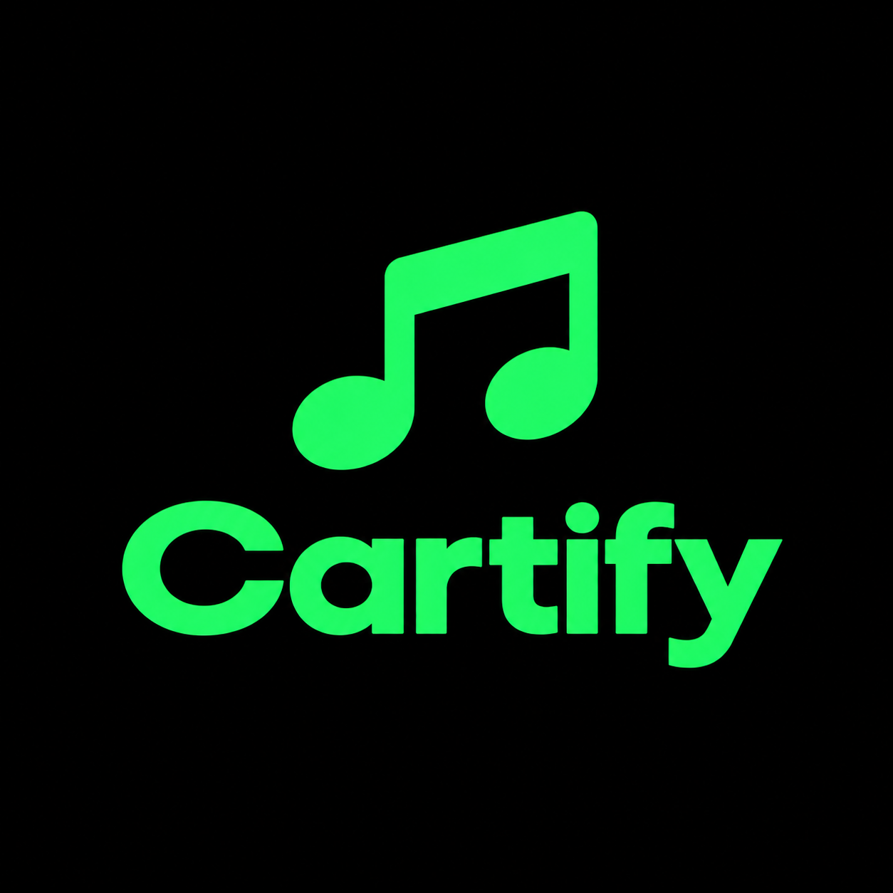

# Cartify

A Java-only Android music app that turns a song into an offline MP3, keeps a local
library, and plays it back with a full media player.

Search for a track, paste a Spotify link, or open a playlist — Cartify finds the audio,
tags it, and saves it to `Music/Cartify` on the device. Nothing is uploaded anywhere, and
the app ships with no API keys.

<p align="center">
  
</p>

---

## What it does

- **Search** any song, artist or album. Results come from Deezer with an iTunes fallback,
  so no key is needed and nothing is rate-limited into silence.
- **Paste a Spotify link** — track, album or playlist — and Cartify resolves the metadata
  from the public embed page, then downloads each track.
- **Stream before you save.** Every result row has a play button that starts the song
  immediately; the download button is a separate decision.
- **Offline library** in `Music/Cartify`, visible to every other music app on the device
  through MediaStore.
- **Full player**: queue, shuffle, repeat, ±10 s seek, sleep timer, lyrics from LRCLIB,
  artwork paging, and a media notification with lock-screen controls.
- **Playlists** that live on the device only.
- **In-app updates** from GitHub releases, with resumable downloads and integrity checks.

## How it works

```
Spotify link OR in-app search
        │
        ├── SpotifyResolver (public embed page)
        └── MusicSearch (Deezer → iTunes fallback)
        │
        ▼
DownloadService (foreground, parallel workers, cancellable per row)
        │  per track:
        ▼
DownloadEngine — yt-dlp search → score candidates → pick one
        │
        ▼
yt-dlp download + ffmpeg → MP3
        │
        ▼
Id3Writer (title/artist/album/cover) → LibraryStore → MediaStore
        │
        ▼
ProgressBus → result rows + notification
```

Playback is independent of the download pipeline: `Playback` owns a `MediaPlayer` and a
queue, and `PlaybackService` keeps it alive in the foreground with a media session.

### Matching is scored, not first-hit

A wrong recording that *looks* saved is the worst failure this app can have, so candidates
are scored on duration, title and artist, and a variant guard rejects live, remix, karaoke,
instrumental and translated-lyrics uploads unless the user actually asked for them.

### Streaming is warmed ahead of the tap

Resolving a stream URL is the whole wait before a song is heard. Cartify resolves the first
rows of every list in the background, primes the connection, and adapts how many rows it
warms to how fast the last resolution actually was — so a tap on a warmed row starts audio
in about a second instead of half a minute.

## Requirements

- Android 7.0 (API 24) or newer, `arm64-v8a` or `x86_64`
- ~110 MB of free space for the app itself (it bundles yt-dlp and ffmpeg)

## Install

Download the newest APK from the [Releases](../../releases) page and open it. Android will
ask once for permission to install apps from this source.

The app can also update itself: when a newer release is published, a banner appears at the
top of the screen and the update downloads and installs from inside the app.

## Build from source

You need JDK 17 and the Android SDK (platform 34, build-tools 34.0.0).

```bash
# point Gradle at your SDK
echo "sdk.dir=/path/to/android-sdk" > local.properties

./gradlew :app:assembleDebug     # debug build
./gradlew :app:assembleRelease   # release build
```

The APK lands in `app/build/outputs/apk/`.

## Project layout

| Path | What lives there |
|---|---|
| `app/src/main/java/com/cartify/app/` | All Java sources (no Kotlin) |
| `MainActivity.java` | The four-tab shell: home, library, downloads, playlists |
| `DownloadEngine.java` | yt-dlp search, scoring, download, stream resolution |
| `Playback.java` / `PlaybackService.java` | MediaPlayer queue and foreground service |
| `PlayerActivity.java` | Full-screen player |
| `Updater.java` | GitHub release check, resumable download, install |
| `docs/PROJECT.md` | The single source of truth for the project's state |
| `tools/` | Build and asset-generation helpers |

## Design rules

1. **No embedded API keys.** A key inside an APK can be extracted and would break for every
   user at once. Search uses keyless catalogues; lyrics use LRCLIB.
2. **Audio comes from a public video source**, because Spotify audio is DRM-protected.
   Metadata still comes from open catalogues.
3. **Nothing is uploaded automatically.** Recent plays, search history and playlists are
   on-device only.
4. **Verify on a device.** A build that compiles is not a build that works.

## Status

Beta, and developed against a single phone. Expect rough edges.

## Licence

No licence file is included yet; treat the code as all rights reserved until one is added.
